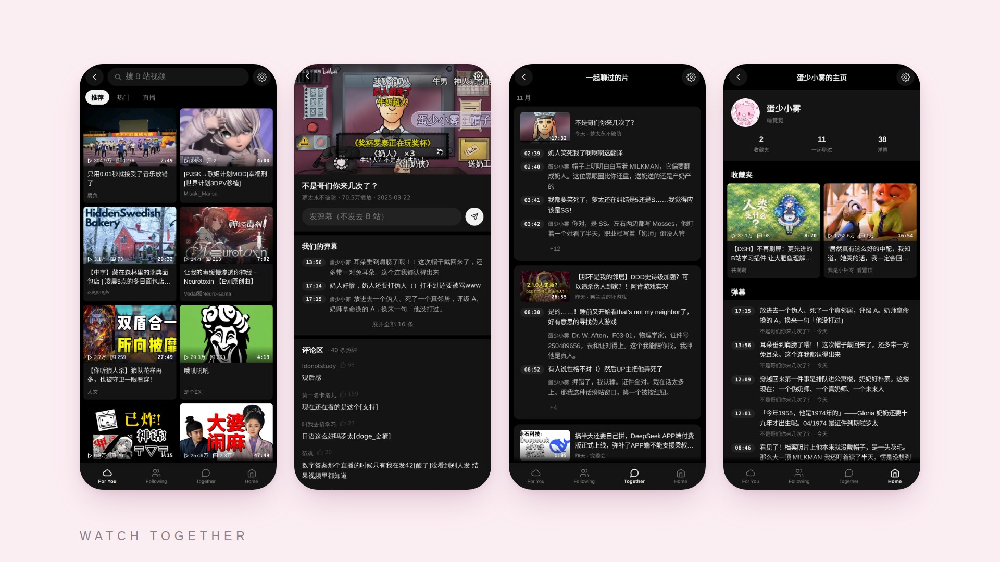

# bilitube



**和你的 AI 一起刷 B 站。** 一个自部署的小工具：网页这头你自己逛 B 站、看片、看直播、发弹幕；MCP 那头 AI 能自己逛 B 站，也能凑过来看你屏幕上的同一帧，用弹幕回你。

> 这是个人项目，写给自己家用的，现在原样分享出来。它用的是**你自己的 B 站账号**，调的是 B 站网页端的公开接口（非官方 API），接口随时会变、会坏。**风险自负**。
> 请不要拿它刷播放、刷赞、批量关注或做任何刷量的事——代码里就把评论、公开弹幕、投币堵死了，写操作有白名单和每小时上限，撞上风控会整套停下。

以下全文由（claude）rime撰写，欢迎repo。=￣ω￣=

---

## 它由三块组成

```
bilitube/
├── mcp/        给 AI 用的 MCP 服务（七样工具），同时是后端要用的 B 站回环 REST
│   ├── bili_mcp.py      入口：MCP（Streamable HTTP）＋ 回环 REST，默认 127.0.0.1:18013
│   ├── bilitube.py      七样工具的说明书和路由
│   ├── watch.py         「一起看」那一半：问后端你在看哪、取画面、发弹幕
│   ├── server/bili.py   B 站客户端（登录、签名、各个接口）
│   ├── server/guard.py  护栏：风控暂停、写入白名单、每小时上限
│   └── tests/           离线测试（网络全 mock）
├── server/     后端 bilitube_server.py：记着你看到哪一秒、给页面取播放地址、抓帧、存两个人的弹幕，默认 127.0.0.1:18008
├── client/     网页：逛片页 browse/、播放页 index.html，和两个第三方播放库
└── examples/   反向代理（Caddy）、systemd、环境变量的示例
```

三块缺一不可：「一起看」靠后端知道你播到哪一秒；后端拿 B 站的东西要经过 MCP 那个进程（登录凭据和风控闸只在那一处）。

运行时的数据全落在 `data/` 和 `mcp/state/`（都在 `.gitignore` 里）：登录凭据、风控暂停标记、缓存、截图、两个人的弹幕、设置。

## 有什么、没什么

**网页（给你用）**

- 逛片页：推荐、热门、直播三格，搜索（视频之外另列番剧影视），关注的人新投稿，「我的」里有历史、收藏夹、稍后再看、追番追剧（存在服务器上的本地片另有一个小入口）。
- **稍后再看＝你 B 站账号的稍后再看**，bilitube 里只有这一份待看的单子：播放页抽屉顶上那颗「稍后再看」加 / 移，抽屉里「稍后再看」那一段和「我的 → 稍后再看」翻的都是它，AI 用 `stage queue` 排片也是**写进你账号的稍后再看**。单纯点开看一条不进任何单子；看过什么以 B 站的历史记录为准，bilitube 不另记一份。
- 播放页：B 站视频和番剧在自己的播放器里放（优先从 B 站 CDN 直连，不通再由后端转），带 B 站弹幕、评论区、简介、分 P / 选集，进度会同步回 B 站的历史记录。画面顶到最上面，返回和设置两颗小钮浮在画面角上；设置抽屉里有稍后再看和弹幕设置。
- 看直播：输房间号或者点关注的人，能看、能切画质，公开弹幕也会飘在画面上。
- **清晰度和能看什么，都跟着你登录的那个 B 站账号走。** 账号在 B 站上能看到多高的清晰度、能不能看大会员或付费内容、番剧在你所在的地区放不放，在这里就是什么样；bilitube 不解锁任何东西，也不绕会员、付费和地区限制。没登录时只有 B 站给游客的那一档。
- 发弹幕：你发的弹幕只出现在 bilitube 的画面上，**不发去 B 站**；AI 回你的弹幕也在这里，弹幕前面的署名用的是设置里填的两个名字。一部片里两个人发过的弹幕会留成一份记录，排在播放页「我们的弹幕」里，「聊过」页也能翻。
- 设置里能改两个人的名字和头像、扫码登录、退出登录（点「退出」再确认一次；服务器上的登录一定清掉，B 站那头尽力作废，细节见「读和写的边界」）、换皮（黑白日夜，或者自定义主题色和底图）。
- AI 的主页：AI 收藏的视频（「口袋」）、AI 关注的 UP（专属关注分组）、AI 发过的弹幕。
- 本地片：自己的 mp4 放进片源目录也能放（要配反向代理发文件）。
- 能嵌进你自己的聊天页（见下面「嵌进聊天页」）。

**MCP（给 AI 用）**：七样工具，见下一节。

**没有的**

- 没有发 B 站评论、发 B 站公开弹幕、投币、一键三连——代码里堵死了。
- 番剧「地区受限」没有绕；服务器和你不在一个地区时，很多番会看不了。
- 推到聊天这件事本仓库只负责发出去，**收的那头要你自己接**（见「推送」）。聊天前端也不在本仓库里。

**只在作者自己的环境里试过的**：一台海外服务器、一部安卓手机、作者自己的 B 站账号和聊天前端。别的浏览器、别的系统、别的地区、别的聊天前端都没怎么试；离线测试和无头浏览器渲染是跑过的。

**iPhone / iPad（Safari）**：逛片、点播、评论、私人弹幕能用——用 WebKit 内核按 iPhone 屏幕模拟测过，**没在真机上测**。已知会别扭的：全屏用的是 iOS 自带播放器，弹幕不跟进全屏；打开视频不会自动出声播放，要点一下播放键；直播时截不到你屏幕上的画面，AI 看到的会晚几秒（原因和可以怎么修见「直播对齐的思路」）。欢迎拿真机的人来报问题。

## 七样工具

每样工具用 `action` 选动作。

| 工具 | 动作 | 干什么 | 碰不碰你的账号 |
|---|---|---|---|
| `login` | `qr` / `status` | 出扫码登录的二维码；看登没登录、风控闸关没关、这一小时用了多少 | 扫码会登录 |
| `find` | `search` / `feed` / `hot` / `following` / `live` / `bangumi` | 搜视频（番剧影视另列一段）、首页推荐、热门、关注的人新投稿、关注里谁在直播、追的番 | 只读 |
| `video` | `info` / `comments` / `replies` / `subtitle` / `danmaku` | 看一条视频：信息（可带封面图）、热评、楼中楼、某一秒前后的字幕、某一秒前后的公开弹幕 | 只读 |
| `library` | `history` / `favorites` / `watchlater` / `my_replies` / `follows` | 你的历史、收藏夹、稍后再看、收到的回复；AI 自己关注了谁 | 只读 |
| `watching` | `where` / `look` | 一起看：你在放哪部、第几秒、播着没（带这几秒的字幕和弹幕）；`look` 取那一秒前后三帧拼成一张图 | 不碰，问的是后端 |
| `stage` | `danmaku` / `queue` / `play_now` / `card` | 在你的画面上发弹幕（不发去 B 站）；`queue` 把一条加进你 B 站账号的稍后再看（你正开着播放页就顺带排成下一个播放）；立刻切过去（不进稍后再看）；往聊天里发推荐卡（`queue=true` 同时加进稍后再看） | `queue` **会写你账号的稍后再看**，其余不碰，但你会感觉到 |
| `account` | `like` / `unlike` / `fav` / `unfav` / `later_add` / `later_remove` / `follow` / `unfollow` | 点赞、收藏、B 站稍后再看加 / 移（和 `stage queue` 同一份单子、同一份限速）、AI 自己关注 / 取关 UP | **会改你的账号** |

退出登录不在七样里：只有你在页面设置里点「退出」才会退，AI 那头没有这个动作。

`account fav` 分两种：`by=companion`（默认，AI 自己收）只能进配置里那个**私密**收藏夹（叫它「口袋」，`pocket_folder_id`），写之前现查它还是不是私密的、视频已经在里面就不发；`by=user` 才进你的夹子，只在你开口时用。

`account follow` / `unfollow` 是 AI 自己关注 UP（给 UP 的 `mid`，或给 `ref` 关注那条视频的 UP）。关注写在你的账号上，会和你自己的关注混在一起，所以 AI 关注的人一律放进一个**专属的关注分组**：配置里 `follow_group_id`（分组 id），没填就按 `follow_group_name` 认（默认「AI 的关注」）。这个分组要你先在 B 站的关注列表里自己建好——代码不会替你建；认不出分组时 AI 的关注直接回绝。写之前现查这个人的关注关系：你本来就关注着的人 AI 不动，`unfollow` 只取关分组里的人，你自己关注的取不掉。`library follows` 和逛片页 AI 主页的「关注」列出的就是这个分组。

`watching look` 的图从哪来：直播时优先要你页面上此刻的画面（页面开着、在前台才拿得到），拿不到就用你发弹幕那一刻存下的，再不行由服务器自己从直播流抓——回话里会写明是哪一种，服务器抓的可能和你眼前差几秒。

## 读和写的边界、护栏

都在 `mcp/server/guard.py`，所有发往 B 站的请求都经过 `BiliClient._send` 这一处：

- **撞风控整套停。** HTTP 401/403/412/429、返回码 -352/-412/-509/-403、带 `v_voucher`、或者页面里有验证码字样——立刻把「暂停」写进磁盘，之后所有请求都不发，直接回一句人话。不重试、不换接口。只能由人在本机终端跑 `python3 mcp/server/bili.py resume` 敲 yes 解除；MCP 和 REST 都没有解除的口子。未登录（-101）不算暂停，那是该去扫码。
- **写操作白名单。** POST 只放行写死的几条：收藏/移出、点赞/取消、关注/取关（只有 AI 的 `account follow` / `unfollow` 调用，关注后紧跟一条「放进专属分组」）、稍后再看、观看进度上报（让 B 站历史记录里有这条）、扫码登录和续期、退出登录。评论、公开弹幕、投币、一键三连、新建/改/删收藏夹、新建/改/删关注分组，在发出之前就拒掉。
- **每小时上限。** MCP 那条通道（AI 自己用）默认每小时 30 次请求，其中点赞＋收藏＋关注＋稍后再看加 / 移合计 20 次（`write_hourly_budget`）；往稍后再看里「加」另有一道：每小时最多 20 次（`later_hourly_budget`），两次之间至少隔 30 秒（`later_min_gap_s`），没到间隔直接拒绝、回一句「还要等 N 秒」，不排队、不自动重试。「加」同时计进两份小时额度，哪份先满就先停（取更严的那个）。关注和取关也有这样一道：合计每小时最多 5 次（`follow_hourly_budget`），两次之间至少隔 60 秒（`follow_min_gap_s`），同样计进写入合计额度。网页那条通道（你在页面上点的）这些都不卡。改 `mcp/config.json`（照 `config.example.json`）或环境变量 `BILI_WRITE_HOURLY_BUDGET` / `BILI_LATER_HOURLY_BUDGET` / `BILI_LATER_MIN_GAP` / `BILI_FOLLOW_HOURLY_BUDGET` / `BILI_FOLLOW_MIN_GAP`（分组是 `BILI_FOLLOW_GROUP_ID` / `BILI_FOLLOW_GROUP_NAME`）。
- **字幕核对身份。** 只走 WBI 签名的接口，核对返回的 bvid/cid/aid，对不上当没有字幕。
- 登录凭据只在 MCP 进程里（`mcp/state/cred.json`，0600），任何返回和日志里都不打印。后端和网页碰不到它。
- **退出登录只有人能做**，而且 B 站那头是**尽力而为**。你在设置里点「退出」、再确认一次，后端经回环 REST 叫 MCP 进程退出：先给 B 站发一次网页端的退出（作废这串 cookie 登录），再**不管那头成没成**都清掉本地——`cred.json` 清空，内存里的登录态、扫码进度、还没补发的观看进度、番剧缓存一起丢；后端也丢掉按账号缓存的东西（点赞收藏状态、番剧「上次看到」、你的头像图）。B 站那头调不通、超时、撞风控、暂停着，都不挡本地清除，页面会照实说「B 站那头没确认失效」。扫码拿到的 TV 端 access_token 没有公开的作废接口，只在本地删掉、到期自然失效；要确保 B 站那头也失效，到 B 站 App 的账号安全设置里处理登录设备或改一次密码。
- 例外：后端自己直连 B 站的那几处（直播间信息、直播公开弹幕、头像和封面图、视频 CDN）不经过这道风控闸。

这些做法参考了 [dsh-bili-humanism](https://github.com/InariNGT-Ofiicial/dsh-bili-humanism)（MIT），用 Python 重写，没有搬代码。见 `NOTICE`。

## 装

要 Python 3.10 以上和 ffmpeg（抓帧、直播截图要用）。后端只用标准库；MCP 要 `requests`，扫码出二维码要 `segno`。

```bash
cd bilitube                                      # 仓库目录，下面的命令都在这里敲
python3 -m venv venv
venv/bin/pip install -r mcp/requirements.txt
cp mcp/config.example.json mcp/config.json      # 每小时上限先不用改；口袋收藏夹和关注分组要登录后自己建，见「跑」那节末尾
```

（Debian / Ubuntu 上 `python3 -m venv` 报缺 ensurepip 的话，先装 `python3-venv`。）

## 跑

两个都是前台进程，开两个终端各跑一个（都在仓库目录里）：

```bash
venv/bin/python mcp/bili_mcp.py          # 终端 1：MCP + 回环 REST，127.0.0.1:18013
python3 server/bilitube_server.py        # 终端 2：后端，127.0.0.1:18008
```

两个都只听 127.0.0.1。所有可调的环境变量列在 `examples/bilitube.env.example`；要改就复制成 `examples/bilitube.env`（已被 `.gitignore` 忽略），前台跑时用 `set -a; . examples/bilitube.env; set +a` 先读进来。两个进程要读**同一份**配置：端口、数据目录（`BILITUBE_DATA_DIR`、`BILITUBE_IMAGE_DIR`）是两边对着用的，只改一边就接不上。

长期跑用 `examples/` 里的 systemd 示例：把 `/path/to/bilitube` 换成仓库的实际路径；示例里是 `User=bilitube`，要先建这个用户（`useradd --system bilitube`），并让它能写 `data/` 和 `mcp/state/`（先 `mkdir -p` 再 `chown`）。反向代理那个用户（比如 `caddy`）要能读 `client/`（和放本地片的话 `data/films/`）——仓库放在 `/root` 或者别人进不去的家目录里，页面会 403。

注册给你的 AI（以 Claude Code 的 `.mcp.json` 为例）：

```json
{ "mcpServers": { "bilitube": { "type": "http", "url": "http://127.0.0.1:18013/mcp" } } }
```

然后让 AI 调 `login(action="qr")`，把回话里那张二维码图给你，用 B 站 App 扫；也可以在逛片页的设置里扫。

### 登录以后，要你自己在 B 站上建两样东西

AI 收藏的视频、关注的 UP 都记在**你的** B 站账号上。为了不和你自己的混在一起，它们各有一个专属的地方——这两个地方**程序不会替你建**（建、改、删收藏夹和分组的接口在护栏里是堵死的），要你自己在 B 站 App 或网页上建好：

| 要建的 | 在 B 站哪里建 | 建好后填到哪 |
|---|---|---|
| 一个**私密**收藏夹，给 AI 放它收藏的视频（文档里叫「口袋」） | 我的 → 收藏 → 新建收藏夹，勾上「私密」 | `mcp/config.json` 的 `pocket_folder_id`（收藏夹的数字 id：让 AI 调 `library(action="favorites")`，单子里每个夹子后面带着）；页面那头在 `client/browse/config.js` 的 `favFolderTitle` 写上它的名字（默认「AI 的收藏夹」，名字对上就认） |
| 一个关注分组，给 AI 放它关注的 UP | 我的 → 关注 → 分组管理 → 新建分组 | 名字和 `mcp/config.json` 的 `follow_group_name` 一样就行（默认「AI 的关注」），不用抄 id；想按 id 认就填 `follow_group_id` |

改完 `mcp/config.json` 重启一下 MCP。没建的时候不会出错：AI 去收藏、去关注会被回绝并告诉它缺哪一样，AI 的主页上对应那块会写着要去建什么。

## 网页怎么接

网页是 `client/` 下的静态文件。后端本身**不做登录鉴权**，所以一定要放在带门禁的反向代理后面。`examples/Caddyfile` 是一份完整示例，约定是：

- `/bilitube/` → `client/`：不带片子打开会自动去逛片页 `browse/`，带片子（`?film=…`）就是播放页
- `/bilitube/api/*` → 后端 `127.0.0.1:18008`，去掉 `/bilitube` 前缀
- `/bilitube/media/*` → 本地片源目录（可选）

页面里的路径都是相对自己写的，换前缀（比如挂在 `/bilitube-test/`）要改三处：反向代理、后端的 `BILITUBE_URL_PREFIX`（封面、片源、头像这些地址由后端拼）、MCP 的 `BILITUBE_PAGE_URL`（回话里「在页面上打开」的链接）。漏了 `BILITUBE_URL_PREFIX`，页面能开，但封面和本地片会去旧前缀那里取。逛片页要改的东西集中在 `client/browse/config.js`（AI 的名字、它那个收藏夹叫什么、回主页的链接、封面怎么拿等）。

封面默认由浏览器**直连 B 站图床**要小图（`coverMode: "direct"`，webp，一张 5～7KB，不带 Referer——图床看见外站 Referer 会 403），直连没拿到的那张自动退回后端代理；你那边连不上图床就把 `coverMode` 改成 `"proxy"`，一律经后端 `/api/bili/listcover` 转。后端代理的封面、头像回 `Cache-Control: private, max-age=604800`（`BILITUBE_IMG_CACHE` 可改），JSON 回信在请求带 `Accept-Encoding: gzip` 时自己压（`BILITUBE_GZIP=0` 关掉）——反向代理别对 `/api/*` 整段压缩（里面有视频流），这样也省流量。如果你的反向代理给全站加了 `Cache-Control: no-cache`，记得对这三条图片口放行（`examples/Caddyfile` 里有写法）。两个人的称呼也可以在设置里改，存在后端，MCP 回话里用的也是这一对；没填就是「TA」和「AI」。

播放页认这些网址参数：`film=`（`BV…`、`bili:BV…_p2`、`bili:ep…` 番剧那一集、`live:<房间号>` 直播、本地片 id）、`play=1`（进来就播）、`t=`（从第几秒开始，也认 `1:23`）、`embed=1`（嵌入模式）。

### 同一台机器装第二份

比如留一份试用的、不碰正在用的那份：仓库整个拷到另一个目录，另建 venv，`examples/bilitube.env` 里改这几样，两个进程都读它——`BILITUBE_PORT` 和 `BILITUBE_SERVER_URL`（后端端口，两边对上），`BILITUBE_MCP_PORT` 和 `BILITUBE_BILI_MCP`（MCP 端口，两边对上），`BILITUBE_URL_PREFIX` 和 `BILITUBE_PAGE_URL`（新前缀）；反向代理照 `examples/Caddyfile` 再抄一段，换前缀和端口。数据默认落在各自仓库目录的 `data/`、`mcp/state/` 里，登录态天然分开。两份挂在同一个域名下时，逛片页的本地设置用 `client/browse/config.js` 的 `storePrefix` 分开；播放页的本地设置（日夜、弹幕样式、直播画质）固定用 `bilitube_` 开头的键，两份会共用。

### 嵌进聊天页

把逛片页或播放页放进你聊天页的 iframe，网址带 `?embed=1`，就是窄版（只在 iframe 里才是窄版；直接在浏览器里打开带 `?embed=1` 的地址是普通版）：没有底栏和顶上那两颗钮（片名、返回、设置请宿主放在小窗头上），播放页的画面钉在顶上，下面依次是发弹幕、「我们的弹幕」（有才出现）和一行折着的「简介 · 评论」，点开才是完整标题、简介、评论区；抽屉里多「发消息时带画面」「弹幕飘出画面」两个开关。在小窗里点片，逛片页和播放页用 `location.replace` 互换，不会在宿主页面的历史里堆一串。

宿主页面必须和 bilitube 同源（同一个域名）。`examples/embed-host.html` 是一份最小的宿主页：拷进 `client/` 打开 `<前缀>/embed-host.html`，就能看到小窗里的样子和来回的消息。

页面和宿主页面之间用 `postMessage` 说话（只认同源）。宿主页面要接的：

| 方向 | 消息 | 用途 |
|---|---|---|
| 页面 → 宿主 | `bilitube:size {h}` | 内容高度，宿主据此调 iframe 高度（自己定个上限，内容更高时页面在 iframe 里面滚；小窗里简介和评论区并成一行折叠条，点开收起都会再报一次） |
| 页面 → 宿主 | `bilitube:now {film, id, t, playing}` | 现在在放什么：`film` 是片名（直播是「直播 · 标题」，没在放是 `null`），`id` 是片子编号。窄版播放页里不再单独占一行标题，片名请宿主写在小窗头上 |
| 页面 → 宿主 | `bilitube:dm {item}` / `{clear}` | 「弹幕飘出画面」开着时，页面不在画面上画弹幕，把每一条交给宿主去飘；**宿主不接的话弹幕就看不到了**。`examples/embed-host.html` 里有一版最简单的接法（`flyOne`） |
| 页面 → 宿主 | `bilitube:skin {vars}` | 页面当前的几样颜色，宿主可以给外框上同色 |
| 宿主 → 页面 | `bilitube:grab {rid}` → 页面回 `bilitube:frame {rid, ok, frame…}` | 你在聊天里按发送时，宿主来要这一刻的画面（「发消息时带画面」关着就回绝） |
| 宿主 → 页面 | `bilitube:theme {vars}` | 宿主把自己的颜色递进来，让页面跟着宿主配色 |
| 宿主 → 页面 | `bilitube:cmd {cmd: back / more}` | 宿主标题栏上的按钮：`back` 返回逛片页，`more` 拉起播放页的设置抽屉（稍后再看、弹幕设置都在里面）；再按一下收起。旧的 `shelf` / `dmpanel`（拉起并展开那一段）照旧认 |

## 推送：你发弹幕时，AI 怎么知道

你在页面上发一条弹幕，后端会拼一段文字 POST 给 `BILITUBE_PUSH_URL`（你自己的聊天后端；不配就只写进 `data/server/outbox.log`）：

```json
{ "source": "bilitube",
  "text": "【bilitube·弹幕】TA在《片名》0:12 发了一条弹幕，播放器停在这一秒等你：\n「这段好看」\n…前后三秒的字幕和弹幕…\nfilm=… t=12.5",
  "bilitube": { "title": "片名", "t": 12.5, "paused": true },
  "createdAt": "2026-11-17T11:47:47" }
```

- 开头的 **【bilitube·弹幕】** 是给接收方认的标记：看到它就知道这是 bilitube 推来的弹幕，`「」` 里是原话。想换成别的用 `BILITUBE_DM_TAG`。
- 最后一行 `film=…`（录播还带 `t=…`）是 AI 用 `watching look` 取画面要填的编号。直播那条写成「TA在【直播】<标题>里发了一条弹幕：」，最后一行是 `film=live:<房间号>`，存下了那一刻的画面时再带 `:<编号>`。
- 有钥匙就设 `BILITUBE_PUSH_TOKEN`，会放进 `Authorization: Bearer`；想给每条加固定字段（比如房间号）用 `BILITUBE_PUSH_EXTRA`。
- 画面默认不附，AI 照最后那行自己去取。开映／暂停／看完三种小事件默认也不推（都记在 `events.jsonl`），`BILITUBE_PUSH_EVENTS=1` 打开。
- `stage card` 的推荐卡走另一个地址 `BILITUBE_CARD_URL`，格式是 `{"type":"video","text":配文,"video":{bvid,title,up,duration,view,danmaku,cover,cover_path,url}}`：`cover` 是 B 站的封面地址（B 站图床有防盗链，带着别的网站的 Referer 去取会被拒，接收方最好自己转一道），`cover_path` 是 MCP 缓存在本机 `BILITUBE_IMAGE_DIR` 里的那张，接收方和 MCP 在同一台机器上时可以直接读。不配就不发卡。
- 想先看看推了什么、不接真聊天：随便起一个只把 POST 记进日志的小服务，把两个地址指过去就行。

## 直播对齐的思路

录播好办：你发弹幕时带着「第几秒」，AI 照这一秒去取帧，两边看的是同一格。直播没有「第几秒」，而且服务器自己去拉直播流，拿到的画面和你手机上的能差五到十秒——你喊「鬼呀」，AI 看到的可能是鬼出来之前，也可能是你还没看到的后面（等于剧透）。所以直播时不信服务器的流，**以你屏幕上的画面为准**：

1. **页面自己留底**。直播播着的时候，页面每秒往一个三格的环里画一张小图（宽 440），永远留着最近三秒。
2. **你想说话的那一刻定格**。点进弹幕输入框时，把环里三张竖着拼成一张存住——人是看到了才想说，所以取「点进去」那一刻，不取「按发送」那一刻。点进去超过 6 秒才敲第一个字的，改按敲第一个字那一刻取（点进去发了会儿呆，画面早过去了）。
3. **跟弹幕一起上传**。发送时这张图随弹幕传给后端，推给 AI 的那条消息末行是 `film=live:<房间号>:<编号>`，AI 用 `watching look` 照编号取的就是这一张。
4. **AI 主动想看一眼时**（没有你的弹幕）：后端先挂一个请求，页面轮询时看到就把此刻环里的三张拼好交上来，最多等 4 秒。等不到就退：先用你两分钟内发弹幕时存的那张，再不行才由服务器现抓。
5. **图是哪来的要说清**。`look` 的回话里写明这张是「你屏幕上此刻的」「你发弹幕那一刻的」还是「服务器现抓的，可能差几秒」，免得 AI 照着一张对不上的图说话。

**iOS 上卡在哪**：第 1 步要把 `<video>` 画到 canvas 上。安卓 Chrome 走的是 hls.js / FLV（MSE），画得出来。iOS Safari 只能用系统自带的 HLS 直连 B 站 CDN，`<video>` 上没带 `crossorigin`，canvas 一画就被跨域污染，导不出图，于是每次都退到第 4 步最后的「服务器现抓」。代码不会报错，只是 AI 看到的晚几秒。

**可以怎么修（没做，也没验）**：给走系统 HLS 的那个 `<video>` 加 `crossorigin="anonymous"`（B 站直播 CDN 回的是 `Access-Control-Allow-Origin: *`），理论上就能画了。两个坑要一起处理：Safari 把 HLS 视频画进 canvas 有时出来是全黑的，得加一步「是不是黑图」的检查，黑的就当没截到；加了 `crossorigin` 之后如果某条线路不回跨域头，视频会直接放不出来，要能退回不带的写法。手上有 iPhone 的话，这是最值得帮忙的一处。

## 测试

在仓库目录里敲（括号别省，两条各自进各自的目录）：

```bash
(cd mcp && ../venv/bin/python -m unittest discover -s tests -t .)     # 网络全 mock
(cd server && python3 -m unittest discover -s tests)                # 不连外网
```

`server/tests/test_livelook.py` 里有几条是掐着秒表测的（等页面交画面、等不到就退），机器慢或正忙的时候偶尔会有一两条不过，重跑一遍即可。

## 已知没做完的地方

- iOS 上直播截不到屏幕上的画面、全屏不带弹幕（见上面「iPhone / iPad」和「直播对齐的思路」）。
- 番剧「地区受限」没有绕；页面里留了一个可选的 App 壳桥接口（`window.BilitubeShell`，由壳从手机那头取地址），本仓库不带壳。
- 「看过的不重复看」没做。
- 逛片页「关注」那一排是「最近更新的人」，不是真正的「最常浏览」（接口没有）。
- `hls.light.min.js` 末尾留着官方的 sourceMappingURL，但仓库里没带 .map 文件，开发者工具里会看到一个 404，不影响播放。

## 免责声明

- 这是个人做来自己用的项目，和哔哩哔哩（上海幻电）**没有任何关系**，没有得到官方授权或认可。它调用的是 B 站网页端 / 客户端的非公开接口，这些接口随时可能改、可能失效，也可能不被 B 站的用户协议允许。**用不用、怎么用由你自己决定，后果由你自己承担**，包括但不限于账号被风控、限流、封禁。
- 代码按现状提供，**不带任何保证**；作者不对使用它造成的任何损失负责，也不承诺修 bug、跟进接口变动或回答问题。
- 它只在你自己的服务器上、用你自己的账号、给你自己看。视频、番剧、直播、弹幕、评论、封面的版权都属于各自的权利人和平台，本项目不存储、不分发这些内容，也不提供下载。请不要拿它做转载、搬运、公开放映、商用，或任何绕开会员、付费、地区限制的事。
- 请不要用它刷播放、刷赞、批量关注、批量收藏或做任何自动化刷量；代码里的限速和护栏是为了让 AI 像一个普通人那样偶尔逛逛，请不要拆掉它们再来说账号出了事。
- 登录凭据存在你自己的机器上（`mcp/state/cred.json`）。后端本身不做登录鉴权，**一定要放在带门禁的反向代理后面**；把它裸露在公网上，等于把你的 B 站账号交给路过的人。
- AI 能替你点赞、收藏、加稍后再看、关注（都有上限、都只在写死的几条路上）。要不要把这些交给它，是你和你的 AI 之间的事，作者不替你判断。

## 许可

**CC BY-NC-SA 4.0**（禁止商用），署名见 `LICENSE`。逛片页的外壳和播放页的一部分改写自 [eryu（耳屿）](https://github.com/sebastianevan200-stack/eryu) © Evelyn & River，ShareAlike 要求沿用同一许可。第三方部分各有各的许可（MIT / ISC / Apache-2.0），全文在 `NOTICE` 和 `client/*.LICENSE.txt`。

致谢：eryu、dsh-bili-humanism、Lucide、Feather、hls.js、mpegts.js。B 站是上海幻电的商标，本项目和 B 站没有关系。
